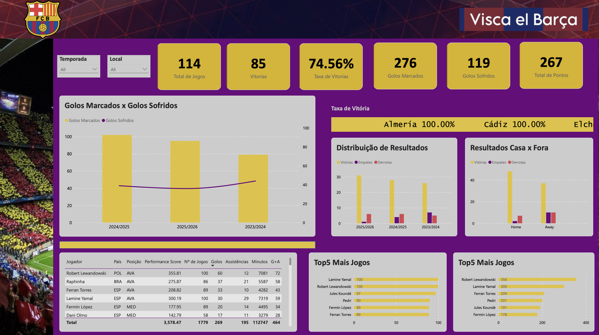

# 🔵🔴 FC Barcelona - 3-Season Performance Analytics (2023/24 - 2025/26)

<p align="center">
  
  
  
  
</p>

## 📌 Project Overview

This repository features an end-to-end **Business Intelligence multi-season analysis** tracking **FC Barcelona across three consecutive La Liga campaigns** (`2023/2024`, `2024/2025`, and `2025/2026`). 

The project evaluates team performance trends over time, home vs. away split efficiencies, result distributions per season, and individual player impacts utilizing key performance scores, playing time, and offensive output ($Goals + Assists$).

---

## 📊 3-Season Macro Performance Summary

> [!NOTE]
> **Cumulative La Liga Performance Snapshot (3 Seasons: 114 Matches)**

| 🏟️ Total Matches | 🏆 Wins | 🤝 Win Rate | ⚽ Goals Scored | 🛡️ Goals Conceded | 📈 Total Points |
| :---: | :---: | :---: | :---: | :---: | :---: |
| **114** | **85** | **74.56%** | **276** | **119** | **267** |

---

## 🖥️ Dashboard Features & Analytical Insights

<p align="center">
  
</p>

### 1. Multi-Season Team Performance Trends
* **Goals Scored vs. Conceded:** Comparative annual evolution demonstrating peak scoring efficiency in `2024/2025` (over 100 goals scored) while tracking defensive stability trends across all three years.
* **Season-by-Season Results:** Yearly breakdowns of Wins, Draws, and Losses highlighting a strong `2025/2026` campaign with over 30 victories.
* **Home vs. Away Split:** Analysis comparing total match outcomes at home (Home) vs. away (Away), illustrating a dominant home record with over 50 wins.

### 2. Player Efficiency & Contribution Matrix
Tracks top offensive contributors using metrics, playing time, and custom calculation modeling:

* **Top Goalscorers & Attackers:**
  * ⚽ **Robert Lewandowski:** 60 Goals, 12 Assists (**72 G+A**) in 100 matches (7,081 min) — Performance Score: `355.81`
  * 🪄 **Lamine Yamal:** 30 Goals, 29 Assists (**59 G+A**) in 100 matches (7,319 min) — Performance Score: `300.19`
  * ⚡ **Raphinha:** 37 Goals, 21 Assists (**58 G+A**) in 86 matches (5,587 min) — Performance Score: `275.87`
  * 🎯 **Ferran Torres:** 33 Goals, 10 Assists (**43 G+A**) in 89 matches (4,282 min) — Performance Score: `208.82`
  * 💎 **Fermín López:** 20 Goals, 14 Assists (**34 G+A**) in 89 matches (4,495 min) — Performance Score: `177.95`
  * 🎯 **Dani Olmo:** 17 Goals, 11 Assists (**28 G+A**) in 58 matches (3,279 min) — Performance Score: `142.79`

* **Squad Utilization Rankings:**
  * **Most Appearances:** Lamine Yamal (100) & Robert Lewandowski (100), followed by Jules Koundé (97) and Pedri (90).
  * **Top Performance Scores:** Robert Lewandowski (356), Lamine Yamal (300), Ferran Torres (209), and Pedri (201).


---

## 🛠️ Tech Stack & Skills Demonstrated

* **Microsoft Excel:** Source data ingestion and historical dataset aggregation across 3 seasons.
* **Power Query:** Data transformation, dynamic date table generation, column normalization, and data cleansing.
* **Data Modeling:** Dimensional modeling connecting multi-year match facts, goal statistics, and player dimension tables.
* **DAX Expressions:** Advanced measures formulated for multi-seasonaggregations, custom **Performance Scores**, win rates (`74.56%`), and goal involvement metrics ($G+A$).
* **Data Visualization:** Barcelona-themed layout design (Navy/Burgundy `#A50044` & Gold `#EDBB00`), custom bar charts, trendlines, and detailed data matrices.

---

## 📂 Repository Structure

```
├── data/                               # Raw match & player datasets (3 seasons)
├── images/                             # Dashboard screenshots and visual assets
│   └── Barcelona_Dashboard.png         # Main Dashboard Export
├── FC_Barcelona_3Seasons_Analysis.pbix # Main Power BI Desktop file
└── README.md                           # Project documentation
```

---

## 📜 License & Intellectual Property

* **Data & Club Rights:** All FC Barcelona logos, team names, and official La Liga match statistics belong to **FC Barcelona** and **LaLiga**.
* **Portfolio Scope:** This project was developed strictly for personal portfolio, educational, and analytical demonstration purposes.
* **Dashboard Design & Code:** © 2026 Diogo Sakellarides Salgado. Free to reference with proper attribution.
